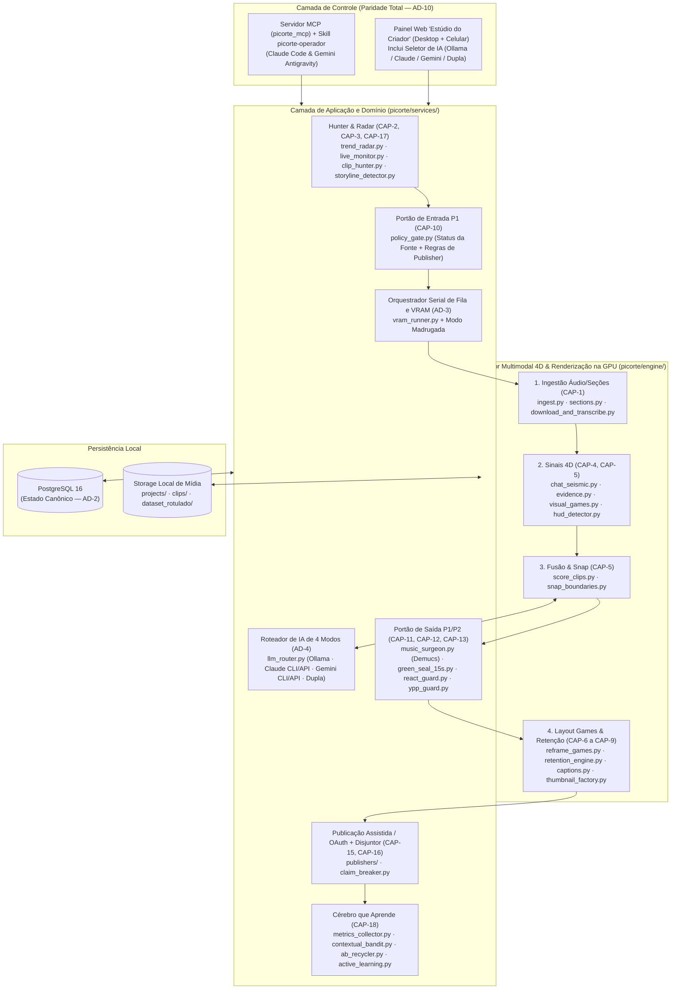
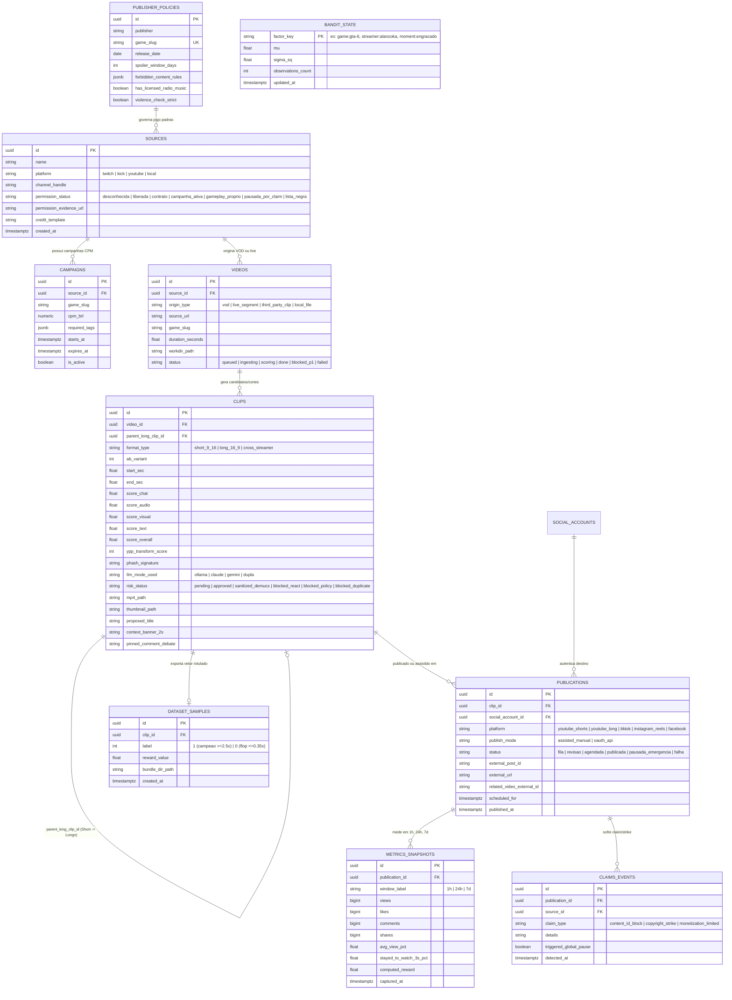

# Architecture Spine — Picorte (Arquitetura de Fusão)

## Design Paradigm

**Modular Monolith + Sequential GPU Pipes-and-Filters sobre PostgreSQL.**

O sistema combina o chassi de processamento local de vídeo do `mehbul/chopify` (MIT) com módulos transplantados do `fralapo/clippyme` (MIT) e do `FujiwaraChoki/supoclip` (uso próprio local), orquestrados por um banco **PostgreSQL local** que detém 100% do estado de domínio (fontes, políticas de risco, campanhas pagas, vídeos, cortes, publicações, snapshots de métricas e Bandit). Todo trabalho pesado de GPU corre em estágios estritamente sequenciais (*Pipes-and-Filters* serializados por lock de VRAM), e toda regra de negócio é exposta simultaneamente para o painel web (**Estúdio do Criador**) e para os agentes (**Claude Code** e **Gemini Antigravity** via MCP/Skill).



## Invariants & Rules

### AD-1 — Chassi Híbrido por Transplante (Zero Reinvenção) [ADOPTED]

- **Binds:** `all`
- **Prevents:** Reescrever do zero módulos de transcrição, legendas `.ass`, detecção de facecam, monitor de lives ou clientes OAuth que já existem testados em `referencias/`.
- **Rule:** Todo épico deve partir dos arquivos-fonte mapeados em `_bmad-output/planning-artifacts/concorrentes.md` (`mehbul_chopify` para ingestão, áudio, visão base, legendas e render; `fralapo_clippyme` para `live_monitor.py` e clientes Twitch/Kick/YT; `FujiwaraChoki_supoclip` para `reaction_layout.py`, `social/` e `mcp/`; `claude-shorts` para `snap_boundaries.py`; `clipify` para `build_pan.py` e `audio_align.py`), adaptando-os à árvore `picorte/` e mantendo os testes existentes verdes.

### AD-2 — PostgreSQL Único como Fonte da Verdade (Sem Multi-Tenant) [ADOPTED]

- **Binds:** `CAP-1` a `CAP-18`
- **Prevents:** Divergência de estado entre os arquivos `.json` do `chopify` e o estado de risco, fila, publicações e Bandit, ou introdução de complexidade inútil de SaaS (`workspace_id`).
- **Rule:** O estado canônico de todas as entidades (`sources`, `publisher_policies`, `campaigns`, `videos`, `clips`, `publications`, `metrics_snapshots`, `claims_events`, `bandit_state`, `dataset_samples`) reside exclusivamente no PostgreSQL local (sem coluna `workspace_id`). Os arquivos `project.json`, `transcript.json`, `audio_features.npz` e `segments.json` em disco são cache de mídia subordinado ao ID do registro em `videos`/`clips`.

### AD-3 — Execução Serializada de VRAM (8 GB / 4 GB) e Modo Madrugada [ADOPTED]

- **Binds:** `CAP-1`, `CAP-5`, `CAP-6`, `CAP-9`, `CAP-11`, `CAP-18`
- **Prevents:** Erros de *CUDA Out of Memory (OOM)* na RTX 4060 Ti (8 GB) ou na GTX 1650 (4 GB) causados por dois modelos pesados alocados simultaneamente na VRAM.
- **Rule:** Todo estágio que aloca modelo em GPU (`faster-whisper`, `YuNet`/`MediaPipe`/`YOLO`, `htdemucs`, `rembg`, `Ollama`, `train_local_scorer`) deve ser executado através do `vram_runner.py` sob um lock global de GPU (`gpu_stage_lock`), rodando em subprocesso dedicado ou invocando `gc.collect()` + `torch.cuda.empty_cache()` ao término do estágio antes do próximo iniciar. Jobs pesados em lote respeitam a janela do **Modo Madrugada / GPU Ociosa** configurada pelo operador.

### AD-4 — Roteador de IA de 4 Modos Selecionável na UI (`llm_router.py`) [ADOPTED]

- **Binds:** `CAP-5`, `CAP-7`, `CAP-9`, `CAP-14`, `CAP-15`
- **Prevents:** Código acoplado a um único provedor de LLM ou cobrança indesejada de API quando o operador quer usar sua assinatura mensal do Claude/Gemini ou o Ollama local.
- **Rule:** Toda chamada a LLM no sistema deve passar exclusivamente por `picorte/ai/llm_router.py`, que lê a configuração escolhida pelo operador na UI (global ou por job) e suporta 4 modos:
  1. `ollama`: chama `http://localhost:11434` (`qwen2.5:7b` na 4060 Ti ou `qwen2.5:3b` na 1650);
  2. `claude`: chama o CLI local autenticado da assinatura mensal (`claude -p --output-format json`) por padrão, ou a SDK Anthropic se o modo API estiver selecionado;
  3. `gemini`: chama o CLI local autenticado da assinatura mensal (`agy -p --output-format json`) por padrão, ou a SDK Google GenAI se o modo API estiver selecionado;
  4. `dupla` (`filter_provider -> companion_provider`): executa a triagem ampla dos candidatos no `filter_provider` (ex.: `ollama` ou `gemini`) e envia os finalistas ao `companion_provider` (ex.: `claude` ou `gemini`) para revisão crítica, escolha final e redação de títulos, faixa de contexto de 2s, texto de thumbnail e 1º comentário.

### AD-5 — Portão Duplo Intransponível do Escudo P1 [ADOPTED]

- **Binds:** `CAP-1`, `CAP-2`, `CAP-3`, `CAP-10`, `CAP-11`, `CAP-12`, `CAP-13`
- **Prevents:** Download de fontes não autorizadas ou entrada na fila de publicação de cortes com música licenciada, palavrão/violência nos primeiros 15s, react de terceiro, baixa transformação ou duplicados.
- **Rule:**
  1. **Portão de Entrada (`policy_gate.assert_can_ingest(source_id, video_meta)`):** chamado obrigatoriamente antes de qualquer `yt-dlp` ou captura de live. Recusa imediatamente fontes com `permission_status IN ('desconhecida', 'pausada_por_claim', 'lista_negra', 'expirada')` ou que violem `publisher_policies`.
  2. **Portão de Saída (`shield_pipeline.verify_and_sanitize(clip_id)`):** chamado obrigatoriamente antes de mudar o status de um corte para `pronto_para_fila`. Executa em sequência: `react_guard` (reprova react de navegador/terceiro) → `music_surgeon` (`Demucs` seletivo nos segundos com música) → `green_seal_15s` (micro-bleep de 0,2s + `***` em palavrões e verificação visual nos primeiros 15s) → `ypp_guard` (exige `ypp_score >= 70` e ausência de colisão de `pHash`/transcrição `> 0.85`).

### AD-6 — Disjuntor Transacional de Claims (`claim_breaker.py`) [ADOPTED]

- **Binds:** `CAP-10`, `CAP-15`, `CAP-16`
- **Prevents:** Continuar publicando cortes de uma fonte que acabou de sofrer claim de bloqueio ou strike em qualquer rede.
- **Rule:** Ao detectar ou receber registro de um claim de bloqueio ou strike em qualquer publicação, `claim_breaker.trip(source_id, reason)` executa em uma única transação atômica no PostgreSQL a mudança de `sources.permission_status = 'pausada_por_claim'` e a suspensão (`status = 'pausada_emergencia'`) de todas as publicações pendentes daquela fonte em todas as 5 redes.

### AD-7 — Área Segura Unificada 9:16 e Exportação Pareada (Short Isca + Longo 3–5 min) [ADOPTED]

- **Binds:** `CAP-6`, `CAP-7`, `CAP-9`, `CAP-15`
- **Prevents:** Legendas queimadas cobertas pelos botões/textos do TikTok, Shorts ou Reels, ou perda do RPM de vídeos longos por falta de conexão entre o Short e o vídeo de 3–5 min.
- **Rule:** Todo corte vertical `1080×1920` posiciona as legendas `.ass` dentro da caixa segura universal (`x` entre `80px` e `920px`, `margin_v = 450px` da base) e a Faixa de Contexto de 2s no topo seguro (`y` entre `240px` e `360px`). Quando um arco gera um Corte Longo `1920×1080` (3–5 min), o sistema gera obrigatoriamente sua `thumbnail.png` (`1280×720`) e grava `clips.parent_long_clip_id` no Short Isca correspondente.

### AD-8 — Publicação Assistida desde o Dia 1 com Transição Transparente para OAuth [ADOPTED]

- **Binds:** `CAP-14`, `CAP-15`, `CAP-18`
- **Prevents:** Ficar bloqueado esperando aprovação das auditorias das APIs (Trilha T1) ou perder o rastreamento de métricas quando o operador publica manualmente no início.
- **Rule:** Todo corte com status `pronto_para_fila` gera um diretório de pacote pronto (`exports/<clip_id>/video.mp4`, `thumbnail.png`, `post_pack.json`) e um cartão de **Publicação Assistida** na UI com botões de 1 clique (*Copiar Título*, *Copiar Descrição + Crédito*, *Copiar 1º Comentário*, *Abrir Pasta do Vídeo*) e um campo *"Colar URL/ID publicado"* para que o coletor de métricas (`1h/24h/7d`) e o Bandit funcionem normalmente mesmo quando o upload foi feito à mão. Quando a conta OAuth da rede estiver ativa e auditada, o mesmo contrato dispara via API oficial.

### AD-9 — Conformidade de Cache Externo (TTL 30 Dias) e Cofre OAuth [ADOPTED]

- **Binds:** `CAP-15`, `CAP-17`, `CAP-18`
- **Prevents:** Violação da política III.E.4.d da YouTube Data API v3 ou vazamento de tokens OAuth em texto puro.
- **Rule:** Toda tabela que armazena metadados de vídeos/canais de terceiros (`external_trends_cache`) possui coluna obrigatória `expires_at <= fetched_at + INTERVAL '30 days'` purgada diariamente. Todos os tokens OAuth em `social_accounts` são cifrados com AES-256-GCM via chave de ambiente (`PICORTE_MASTER_KEY`).

### AD-10 — Paridade entre Painel Web ("Estúdio do Criador") e Servidor MCP [ADOPTED]

- **Binds:** `CAP-14`
- **Prevents:** Regras de negócio duplicadas ou funcionalidades disponíveis apenas na tela web e inacessíveis pelo Claude/Gemini (ou vice-versa).
- **Rule:** Nenhuma rota HTTP (`picorte/api/`) nem ferramenta MCP (`picorte/mcp/`) contém lógica de domínio ou SQL direto; ambas chamam exclusivamente as funções da camada `picorte/services/`.

## Consistency Conventions

| Concern | Convention |
| --- | --- |
| **Idioma (UI, logs de usuário, docs, código)** | Interface, mensagens de erro ao usuário, prompts de copywriting e documentação sempre em **português do Brasil**. Identificadores de código, tabelas e colunas SQL em `snake_case` (inglês técnico consistente com a base do `chopify`). |
| **Datas e Fuso Horário** | Timestamps gravados no PostgreSQL sempre em `TIMESTAMPTZ` (UTC) e exibidos na UI e no MCP no fuso `America/Sao_Paulo` (Brasília). |
| **Configuração e Segredos** | Variáveis em `.env` (lidas por `picorte/config.py`), nunca commitadas. Segredos OAuth cifrados no banco (`crypto_vault.py`). |

## Stack

| Name | Version |
| --- | --- |
| Python | `3.12.x` |
| PostgreSQL | `16.x` |
| FFmpeg (com `libass` + `h264_nvenc`) | `6.1+` |
| `faster-whisper` | `1.1.x` |
| `opencv-python` (inclui `FaceDetectorYN` / YuNet) | `4.10.x` |
| `mediapipe` | `0.10.x` |
| `demucs` (`htdemucs`) | `4.0.x` |
| `rembg` (com `onnxruntime-gpu`) | `2.0.x` |
| `yt-dlp` | `2026.10+` |
| `streamlink` | `7.0+` |
| `fastapi` + `uvicorn` | `0.121.x` / `0.32.x` |
| `psycopg` (v3 async/sync) | `3.2.x` |
| `numpy` | `1.26.x+` |
| `pytest` | `8.4.x` |

## Structural Seed

### 1. Árvore do Repositório (`picorte/`)

```text
projeto-cortes/
├── picorte/
│   ├── config.py                  # Configurações, caminhos e detecção de GPU/VRAM
│   ├── db/
│   │   ├── schema.sql             # DDL completo do PostgreSQL (10 tabelas)
│   │   ├── connection.py          # Pool psycopg3 e migrações
│   │   └── repositories/          # Acesso a dados (sources, clips, publications, bandit)
│   ├── ai/
│   │   └── llm_router.py          # Roteador 4 modos: Ollama | Claude | Gemini | Dupla (Filtro+Acompanhamento)
│   ├── engine/                    # Baseado em mehbul/chopify + transplantes
│   │   ├── vram_runner.py         # Lock serial de VRAM (8GB/4GB) + Modo Madrugada
│   │   ├── ingest.py              # Do chopify: download áudio/blocos 30m e vídeo sob demanda
│   │   ├── sections.py            # Do chopify: recorte de seções de fontes longas (+2h)
│   │   ├── transcribe.py          # Do chopify: faster-whisper com timestamps por palavra
│   │   ├── chat_seismic.py        # Sismógrafo do Chat da Live (msgs/s + emotes)
│   │   ├── evidence.py            # Do chopify: linha do tempo acústica 1 Hz (RMS, flux, >4kHz)
│   │   ├── visual_games.py        # Do chopify (visual.py) + YuNet + MAR (facecam) + hud_detector.py
│   │   ├── score_clips.py         # Fusão 4D (Chat + Áudio + Visão + LLM Router) + snap_boundaries.py
│   │   ├── reframe_games.py       # Do supoclip (reaction_layout.py) + Layout Dinâmico + Sniper Crop
│   │   ├── retention_engine.py    # Cold Open 1,5s + Faixa Contexto 2s + Seamless Loop + Cross-Streamer
│   │   ├── captions.py            # Do chopify: motor .ass com Área Segura Unificada (AD-7)
│   │   ├── render_clips.py        # Do chopify: renderizador FFmpeg/NVENC (9:16 curto e 16:9 longo 3-5m)
│   │   └── thumbnail_factory.py   # Fábrica de Thumbnail 1280x720 (MAR frame + rembg + DESIGN.md)
│   ├── shield/                    # Escudo Anti-Strike (P1 — AD-5 e AD-6)
│   │   ├── policy_gate.py         # Status da fonte + regras de publisher/jogo (ex.: GTA 6)
│   │   ├── music_surgeon.py       # Demucs seletivo nos segundos com música licenciada
│   │   ├── green_seal_15s.py      # Micro-bleep 0,2s + '***' e checagem visual nos primeiros 15s
│   │   ├── react_guard.py         # Detector visual de React Perigoso (navegador/player alheio)
│   │   ├── ypp_guard.py           # Score mínimo YPP (>=70) + deduplicação perceptual pHash
│   │   └── claim_breaker.py       # Disjuntor transacional global ao 1º claim/strike
│   ├── hunter/                    # Olho para Fora (CAP-2, CAP-3, CAP-17)
│   │   ├── trend_radar.py         # Twitch Top Games/Streams + YT Gaming + Calendário + Campanhas CPM
│   │   ├── live_monitor.py        # Do clippyme: monitor assíncrono de lives (Twitch/Kick/YT)
│   │   ├── clip_hunter.py         # Caçador e re-transformador de Twitch Clips/Shorts de terceiros
│   │   └── storyline_detector.py  # Detector de Treta / Pingue-Pongue entre streamers
│   ├── publishers/                # Do supoclip (social/) + pacote de Publicação Assistida (AD-8)
│   │   ├── crypto_vault.py        # Cifragem AES-256-GCM de tokens OAuth
│   │   ├── export_pack.py         # Pacote pronto para publicação manual assistida + vínculo de URL
│   │   ├── youtube.py             # Shorts + Longo + Thumbnail + Related Video + 1º Comentário
│   │   ├── tiktok.py              # TikTok Content Posting API
│   │   ├── instagram.py           # Instagram Graph API (Reels)
│   │   └── facebook.py            # Facebook Pages Graph API
│   ├── brain/                     # Olho para Dentro (P3 e P4 — CAP-18)
│   │   ├── metrics_collector.py   # Coletor de snapshots 1h / 24h / 7d
│   │   ├── reward.py              # Fórmula anti-clickbait ponderada por retenção e campanha CPM
│   │   ├── contextual_bandit.py   # Thompson Sampling contextual por variável com decaimento gamma
│   │   ├── ab_recycler.py         # Reciclagem A/B de Gancho ('Segunda Vida')
│   │   ├── active_learning.py     # Autocaptura de dataset_rotulado/ (>2.5x vs <0.35x mediana)
│   │   └── train_local_scorer.py  # Treino local do classificador multimodal na RTX 4060 Ti
│   ├── services/                  # Fachada unificada de domínio consumida pela Web e pelo MCP
│   ├── api/                       # Rotas FastAPI + servidor do painel Estúdio do Criador
│   ├── web/                       # Frontend 'Estúdio do Criador' (DESIGN.md, tokens.css, PC + Celular)
│   └── mcp/                       # Servidor MCP (picorte_mcp) para Claude Code e Gemini Antigravity
└── tests/                         # Suíte pytest (unitários, integração e portões críticos P0/P1)
```

### 2. Modelo de Dados Canônico (PostgreSQL — ERD)



## Capability → Architecture Map

| Capability / Area | Lives in | Governed by |
| --- | --- | --- |
| `CAP-1` (Ingestão VODs +2h em blocos de áudio/seções) | `picorte/engine/ingest.py`, `sections.py`, `transcribe.py` | `AD-1`, `AD-2`, `AD-3`, `AD-5` |
| `CAP-2` (Monitor de Lives Ao Vivo Twitch/Kick/YT) | `picorte/hunter/live_monitor.py` | `AD-1`, `AD-5` |
| `CAP-3` (Caçador e Transformador de Clipes de Terceiros) | `picorte/hunter/clip_hunter.py` | `AD-1`, `AD-5`, `AD-9` |
| `CAP-4` (Sismógrafo do Chat da Live) | `picorte/engine/chat_seismic.py` | `AD-2` |
| `CAP-5` (Pontuador Multimodal 4D + Seletor de IA na UI) | `picorte/engine/score_clips.py`, `evidence.py`, `visual_games.py`, `picorte/ai/llm_router.py` | `AD-1`, `AD-3`, `AD-4` |
| `CAP-6` (Reenquadramento 9:16 Games: Layout Dinâmico + Sniper Crop) | `picorte/engine/reframe_games.py` | `AD-1`, `AD-3`, `AD-7` |
| `CAP-7` (Retenção: Cold Open 1,5s + Contexto 2s + Loop + Área Segura) | `picorte/engine/retention_engine.py`, `captions.py`, `render_clips.py` | `AD-1`, `AD-7` |
| `CAP-8` (Compilação Cross-Streamer Automática) | `picorte/engine/retention_engine.py` (`cross_streamer`) | `AD-1`, `AD-7` |
| `CAP-9` (Par Short Isca + Longo 3–5 min + Fábrica de Thumbnail) | `picorte/engine/render_clips.py`, `thumbnail_factory.py` | `AD-3`, `AD-7` |
| `CAP-10` (Portão de Status da Fonte e Políticas de Publisher) | `picorte/shield/policy_gate.py`, `picorte/db/` | `AD-2`, `AD-5` |
| `CAP-11` (Cirurgia Seletiva de Música com `Demucs`) | `picorte/shield/music_surgeon.py` | `AD-3`, `AD-5` |
| `CAP-12` (Filtro Selo Verde 15s + Detector de React Perigoso) | `picorte/shield/green_seal_15s.py`, `react_guard.py` | `AD-3`, `AD-5` |
| `CAP-13` (Score Mínimo de Transformação YPP + Deduplicação `pHash`) | `picorte/shield/ypp_guard.py` | `AD-2`, `AD-5` |
| `CAP-14` (Controle via MCP/Skill + Painel Web Estúdio do Criador + Seletor de IA) | `picorte/web/`, `picorte/api/`, `picorte/mcp/`, `picorte/services/` | `AD-4`, `AD-8`, `AD-10` |
| `CAP-15` (Publicação Assistida e OAuth nas 5 Redes + 1º Comentário + Related Video) | `picorte/publishers/` | `AD-1`, `AD-7`, `AD-8`, `AD-9` |
| `CAP-16` (Monitor de Claims e Disjuntor Global Automático) | `picorte/shield/claim_breaker.py` | `AD-2`, `AD-6` |
| `CAP-17` (Radar de Tendências, Detector de Treta e Campanhas Pagas CPM) | `picorte/hunter/trend_radar.py`, `storyline_detector.py` | `AD-2`, `AD-9` |
| `CAP-18` (Snapshots 1h/24h/7d, Bandit com Esquecimento, Reciclagem A/B e Active Learning) | `picorte/brain/` | `AD-2`, `AD-3`, `AD-8` |

## Deferred

- **Aluguel de GPU externa em nuvem (RunPod / Vast.ai):** adiado até que o volume diário de vídeos ultrapasse a capacidade da RTX 4060 Ti local somada ao Modo Madrugada. Como o `vram_runner.py` consome jobs da tabela `videos` no PostgreSQL, apontar um worker remoto no futuro não exigirá mudança na arquitetura.
- **Arquitetura de pesos finos do classificador próprio (`train_local_scorer.py` — XGBoost vs MLP PyTorch):** adiado para o Épico 7, quando a pasta `dataset_rotulado/` tiver acumulado os primeiros exemplos reais dos canais.
