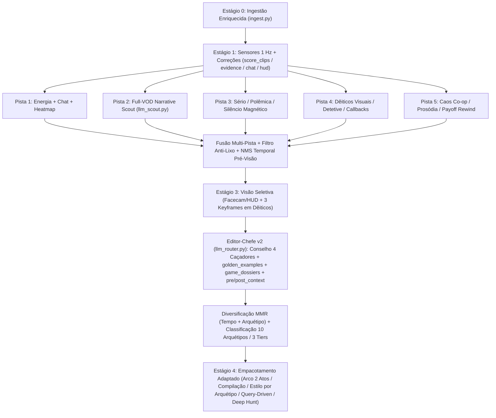

# Épico 3.5 — Motor de Caça Extraordinária de Cortes Gamers (Blueprint Técnico Completo)

- **Projeto:** `projeto-cortes` (**Picorte** / canal **Bomba Clips**)
- **Data:** 2026-11-19
- **Origem:** Sessão autônoma de brainstorming [`brainstorm-deteccao-cortes-extraordinarios-games-2026-11-19`](../brainstorming/brainstorm-deteccao-cortes-extraordinarios-games-2026-11-19/brainstorm.html) (112 ideias, 9 técnicas) + [`sprint-change-proposal-2026-11-19.md`](sprint-change-proposal-2026-11-19.md)
- **Portão de Pilares (`cortes-pilares`):** **SEGUE** ✅ (`P1 > P2 > P3 > P4 > P5`, `A1–A5`, zero SaaS, zero ferramenta paga de autoclip, 100% multiplataforma Windows 11 + Linux Ubuntu `AD-11`, VRAM serializada `AD-3`)
- **Execução:** Onda 1 (`3.5.1`–`3.5.3`) → validação em VOD real → Onda 2 (`3.5.4`–`3.5.5`), seguindo `superpowers:writing-plans` → `test-driven-development` → `verification-before-completion`.

---

## 1. Problema Raiz, Exemplo-Âncora e Bugs Reais a Eliminar

### 1.1. O Exemplo-Âncora ("Caso Geladeira do Alanzoka")
Referência real: `https://www.youtube.com/shorts/E_x5lh7uPCA` — o streamer Alanzoka entra calmamente numa cena, abre a geladeira para testar se a Rockstar corrigiu a animação do trailer de GTA 6 (onde o item "spawnava" direto na mão do Jason) e comenta em tom baixo e irônico.

Esse tipo de clipe tem:
- **Baixíssima energia acústica** (sem grito, sem explosão, sem pânico);
- **Altíssima carga cultural e visual** (callback de trailer + verificação de detalhe + humor inteligente);
- **Altíssimo poder de rewatch e compartilhamento** ("olha o detalhe que ele foi testar!").

### 1.2. Autópsia dos 5 Gargalos no Código Atual
| # | Gargalo comprovado no código | Onde ocorre | Sintoma real |
|---|---|---|---|
| **G1** | **Porta estreita enviesada por volume** | `score_clips.py` (`deduped[:30]`) | Uma única nota linear privilegia grito/energia; diamantes silenciosos morrem em `#45` antes de chegar ao `LLMRouter`. |
| **G2** | **Prompt de 4 linhas cego de contexto** | `picorte/ai/llm_router.py:30-38` | O LLM não sabe o título do vídeo, o jogo, os capítulos, o que aconteceu 20s antes/15s depois, os memes do jogo nem quais arquétipos buscar. |
| **G3** | **Penalização de dêiticos visuais** | `score_clips.py` (`ANAPHORIC_OPENERS`) | Frases iniciando com `"olha isso"`, `"espera"`, `"ele"`, `"olha a mão"` são punidas como "início fraco", quando em lives de games são ponteiros para ouro na tela. |
| **G4** | **Loop visual desperdiçado no mesmo minuto** | `score_clips.py` (`[vision 1/12 .. 12/12]`) | No projeto real `19059a3dc07d`, **11 das 12 análises visuais** rodaram em janelas sobrepostas entre `1609s–1649s` porque o NMS temporal não rodava antes da visão. |
| **G5** | **Saturação do `hud_detector.py` + descarte de `heatmap`/`chapters`** | `picorte/engine/hud_detector.py` e `ingest.py` (`probe_source`) | YOLO no HUD pontua classe COCO `person` como evento de HUD (`hud_score = 10.0` constante) e `ingest.py` descarta `heatmap` (*Most Replayed*) e `chapters` que o `yt-dlp` já entrega de graça. |

---

## 2. Taxonomia Canônica: 16 Arquétipos do Brainstorming → 10 Arquétipos Operacionais + 3 Tiers

Todos os **16 arquétipos** mapeados no brainstorming estão cobertos sem exceção dentro de **10 arquétipos canônicos** (enxutos o bastante para o LLM, a UI e o Bandit do Épico 7 classificarem com alta precisão) + **3 tiers de prioridade editorial**.

### 2.1. Os 3 Tiers
- **`ouro`:** Corte extraordinário, raro, com alto potencial de rewatch, comentários ou compartilhamento fora da bolha (ex.: callback cultural impecável, caos cinematográfico, frase lapidar viral).
- **`forte`:** Corte muito bom e confiável para manter frequência e retenção sólida no canal.
- **`experimental`:** Aposta diferenciada (ex.: micro-clipe de 9s, arco ousado, detalhe de nicho) ideal para testar nos ~20% de exploração do canal.

### 2.2. Matriz Completa dos 10 Arquétipos Canônicos

| # | ID Canônico (`archetype`) | Arquétipos do Brainstorm Cobertos | Sinais Principais de Captura | Duração Ideal | Estilo de `context_banner_2s` e Cold Open |
|---|---|---|---|---|---|
| 1 | **`callback_oculto`** | **#1** Callback Cultural & Piada Oculta + **#14** Nostalgia & Comparação de Eras | `llm_scout` (full-VOD), `game_dossiers/<jogo>.json`, TF-IDF local (`trailer`, `corrigiram`, `arrumaram`, `lembra`, `antes`, nome do estúdio), Modo Detetive (`deixa eu ver`, `será que`), keyframes seletivos | Micro `8–14s` ou Short `15–45s` | **Tradutor sem spoiler** (`"No trailer o item spawnava na mão — ele foi testar"`). Cold Open suave ou desabilitado se der spoiler da punchline. |
| 2 | **`caos_coop`** | **#2** Caos Cooperativo & Efeito Dominó + **#13** Drama, Traição & Política de Grupo (RP/Dedução) | Sobreposição vocal / turnos frenéticos, eco coletivo (`freia freia`, `grava grava`), *blame game* (`foi você!`, `culpa sua`), ritmo de risada (3–6 Hz), picos de chat (`KKKK`, `OMEGALUL`) | Short `20–59s` ou Estendido `60–120s` | Badge vibrante de caos + Cold Open Reverso de 1,5s no pico da gritaria/riso. |
| 3 | **`rage_tilt`** | **#3** Rage, Tilt & Espiral de Frustração | Escada do tilt (múltiplos picos/falhas em 3–5 min), alta energia vocal/banda aguda, palavrões/léxico PT-BR (`coringou`, `não tanko`, `que jogo`), MAR alto + movimento brusco de cabeça, HUD morte/derrota | Short `15–59s` ou Longo `120–300s` (espiral completa) | Badge de impacto + Cold Open Reverso no ápice do surto (respeitando Selo Verde 15s no Épico 4). |
| 4 | **`serio_realtalk`** | **#4** Sério, Vulnerável & Real Talk + **#12** Storytelling & Causos de Vida | **Silêncio Magnético** (queda de energia, cadência lenta, baixa variância), tela parada/menu/farm, 1ª pessoa (`papo reto`, `sendo sincero`, `na real`), `gaze-to-camera`, quebra semântica de assunto, `llm_scout` | Short `30–59s` ou Estendido `60–120s` | **Visual sóbrio/editorial** (sem badge gritante nem flash frenético; Cold Open opcional usando a "Frase de Ouro" falada). |
| 5 | **`polemica_hottake`** | **#5** Polêmica, Opinião Impopular & Hot Take da Indústria | Estrutura Tese + Contraponto (`não dá pra defender`, `passam pano`, `vou tomar hate`, `preço`, `nerfaram`, `microtransação`), `BASED`/`TRUE` no chat, `llm_scout` com lente Opinião/Polêmica | Short `25–59s` ou Estendido `60–120s` | Badge editorial de debate + 1º Comentário Fixado polarizador obrigatório. |
| 6 | **`descoberta_detalhe`** | **#6** Descoberta, Easter Egg, Segredo & Física Insana + **#15** Glitch Quebrando Imersão | Formato *Mythbusters Gamer* (`vamos ver se dá pra`, `será que quebra?`), dêiticos visuais (`olha isso`, `repara`, `olha a mão`), avatar parado inspecionando objeto, keyframes seletivos, `game_dossiers/` | Micro `10–14s` ou Short `15–50s` | Badge curioso ("Olha o detalhe que ele achou…") + Sniper Crop / foco no detalhe. |
| 7 | **`clutch_fail`** | **#7** Clutch, Jogada Impossível & Fail Cinematográfico | HUD/Killfeed limpo (sem `PERSON`), contraste emocional início×fim, explosão de fluxo óptico, `POG`/`F`/`CLUTCH` no chat, `heatmap` (*Most Replayed*) | Short `15–55s` ou Longo `120–240s` | Badge esportivo/impacto + Cold Open Reverso no lance decisivo. |
| 8 | **`susto_tensao`** | **#8** Pânico, Susto & Tensão Silenciosa | Assinatura Susto: silêncio tenso (`>2s`) → spike acústico `>18 dB` em `<300ms`, MAR + recuo brusco na facecam, `MonkaS`/`JESUS` no chat | Micro `8–14s` ou Short `15–40s` | Badge de tensão ("Espera até o final…") — **sem Cold Open de spoiler** do susto! |
| 9 | **`deadpan_karma`** | **#10** Ironia Seca, Deadpan & Timing Cômico + **#11** Previsão Profética & Instant Karma | **Contradição Fala × Tela** (`relaxa, tá seguro` → caos/derrota em `<10s`), prosódia plana + elogio extremo após bug, `gaze-to-camera` silencioso (`>1.2s`), facepalm/fuga do quadro | Micro `8–14s` ou Short `15–35s` | Badge irônico enxuto + corte seco no ápice do timing cômico (ótimo para Seamless Loop >100% retenção). |
| 10 | **`chat_trolagem`** | **#9** Interação Genial com Chat/Donate/TTS + **#16** Meta-Momento & Bastidores Ao Vivo | Menções diretas ao chat/donate/TTS, risadinha cúmplice pré-caos, `CLIP`/`CORTA ESSA` no chat, desaparecimento do rosto/invasão de quadro (pet/entrega/microfone), `llm_scout` | Micro `10–14s` ou Short `15–50s` | Badge descontraído contextualizando a mensagem do chat ou o imprevisto ao vivo. |

---

## 3. Arquitetura do Motor de Caça Extraordinária (5 Estágios)



### Princípios Arquiteturais Inegociáveis
1. **Nunca uma régua única:** nenhum candidato silencioso compete na mesma soma de energia que um grito; cada uma das 5 pistas tem **cota reservada garantida** até chegar ao Editor-Chefe v2.
2. **LLM vê a live inteira antes do funil cortar:** o **Full-VOD Narrative Scout (`llm_scout.py`)** compacta a transcrição inteira em blocos numerados `[S0001]` (com Map-Reduce para lives de 4h+) e pesca joias narrativas/culturais de qualquer minuto do VOD sem depender de volume.
3. **Sem alucinação de timestamps:** o Scout e o Editor-Chefe escolhem `sentence_id` (`start_sid`, `end_sid`) em vez de segundos inventados; o Python converte `sentence_id` nos timestamps exatos do `faster-whisper` + `snap_boundaries.py`.
4. **Espelhamento obrigatório (`AD-1`):** toda edição em `ingest.py`, `score_clips.py`, `render_clips.py`, `projects.py`, `chopify.py` mantém sincronia 1:1 com `picorte/engine/*.py`.
5. **VRAM Serial (`AD-3`) e Multiplataforma (`AD-11`):** sinais de texto/áudio/chat rodam em CPU; visão roda só após NMS temporal; modelos opcionais (`YAMNet`/`PANNs`) têm fallback limpo em CPU pura se ausentes; caminhos sempre via `pathlib.Path`.

---

## 4. Detalhamento Técnico por História — ONDA 1 (Impacto Imediato)

### Story `3.5.1` — Correções Estruturais de Precisão + Sinais Gratuitos do YouTube
**Objetivo:** eliminar os 3 bugs comprovados do motor atual e aproveitar dados gratuitos que o `yt-dlp` já fornece.

**Arquivos afetados:**
- `ingest.py` + `picorte/engine/ingest.py`
- `score_clips.py` + `picorte/engine/score_clips.py`
- `picorte/engine/hud_detector.py`

**Especificação técnica:**
1. **Ingestão de `heatmap` (*Most Replayed*) e `chapters` (`ingest.py::probe_source`):**
   - Persistir em `source_meta.json`:
     ```json
     {
       "title": "string",
       "channel": "string",
       "duration": 3600.0,
       "detected_game": "gta6",
       "chapters": [{"title": "Intro", "start_time": 0.0, "end_time": 420.0}],
       "heatmap": [{"start_time": 120.0, "end_time": 156.0, "value": 0.94}]
     }
     ```
   - Função pura `extract_heatmap_peaks(heatmap, min_value=0.65, min_gap_sec=30.0)` que encontra máximos locais do *Most Replayed* e os promove diretamente como sementes candidatas obrigatórias no `discover()`.
   - Função `detect_game_slug(title, chapters, dossiers_dir)` que casa título/capítulos com os arquivos em `picorte/ai/game_dossiers/*.json` (ex.: `"GTA VI"` / `"GTA 6"` / `"Grand Theft Auto"` → `gta6`).
2. **NMS Temporal Obrigatório ANTES do Loop Visual (`score_clips.py`):**
   - Extrair função `temporal_nms(candidates, iou_threshold=0.35, min_center_gap_sec=20.0, limit=12)`.
   - Aplicar `temporal_nms()` **antes** de executar `[vision 1/N .. N/N]`, garantindo que os 12 slots visuais cubram **12 momentos temporalmente distintos** da live (eliminando o bug `1609s–1649s` de `19059a3dc07d`).
3. **Limpeza do `hud_detector.py`:**
   - No passo YOLO de HUD, ignorar explicitamente a classe COCO `person` (id `0`) e qualquer detecção dentro da caixa da facecam (`exclude_box`), restringindo pontuação de HUD a eventos reais (banners OCR de kill/vitória/morte/conquista, ícones/templates e mudanças bruscas nas zonas periféricas).
   - Recalibrar escala para que cenas normais pontuem `0.0–2.5` e eventos reais de HUD se destaquem em `6.0–10.0`.
4. **Revisão de `ANAPHORIC_OPENERS` → Detector de Dêiticos Visuais (`score_clips.py`):**
   - Remover a penalização cega sobre ponteiros visuais de gameplay (`"olha isso"`, `"olha a mão"`, `"espera"`, `"repara"`, `"tá vendo"`, `"aqui ó"`, `"vê se"`, `"olha ali"`).
   - Em vez de penalizar, marcar o candidato com `has_visual_deictic = True`, acionar expansão de setup (retrocedendo 4–8s até a frase de contexto) e sinalizar para inspeção visual prioritária.

**Critérios de Aceite (AC):**
- `probe_source()` persiste `heatmap`, `chapters`, `title`, `channel` e `detected_game` quando presentes (e degrade limpo `[]`/`None` quando ausentes ou arquivo local).
- Com 25 janelas sobrepostas no mesmo minuto e 10 espalhadas pelo VOD, `temporal_nms` seleciona janelas distintas (IoU `<= 0.35`) antes do loop `[vision]`.
- Frame contendo apenas streamer/personagem (`COCO person`) não satura `hud_score` (`hud_score < 3.0`).
- Candidato começando com `"olha a mão dele, arrumaram!"` recebe `has_visual_deictic=True` e **não** sofre penalização anafórica.

---

### Story `3.5.2` — Recall Multi-Pista (5 Pistas), Payoff-First Rewind, Full-VOD Narrative Scout e Durações Flexíveis
**Objetivo:** acabar com a porta estreita única (`deduped[:30]`), fazer o LLM enxergar a live inteira e gerar janelas com duração natural para cada tipo de momento.

**Arquivos afetados:**
- **Novo:** `picorte/ai/llm_scout.py` (Full-VOD Narrative Scout com Map-Reduce para lives 4h+ e saída por `sentence_id`)
- **Novo:** `picorte/engine/multitrack.py` (5 pistas com cota reservada, léxico PT-BR por arquétipo, TF-IDF local, Payoff-First Rewind, Silêncio Magnético, Filtro Anti-Lixo)
- `score_clips.py` + `picorte/engine/score_clips.py`

**Especificação técnica:**
1. **Filtro Anti-Lixo de Alta Precisão (*Decompositores*):**
   - Penaliza/filtra explicitamente blocos dominados por: leitura prolongada de subs/donates genéricos (`"obrigado pelo sub"`, `"valeu pelos X meses"`), ad breaks/patrocínio (`"cupom"`, `"link na descrição"`, `"oferecimento"`), ajuste técnico de microfone/OBS e pausas de intervalo (`"já volto"`, `"vou no banheiro"`).
2. **Léxico Vivo Gamer PT-BR + Anomalia TF-IDF Local (`multitrack.py`):**
   - Dicionário nativo por família de arquétipo (sem viés em inglês):
     - *Detetive/Callback:* `"deixa eu ver"`, `"será que"`, `"vamos testar"`, `"no trailer"`, `"arrumaram"`, `"corrigiram"`, `"escola rockstar"`, `"lembra disso"`, `"prometeram"`, `"detalhe"`, `"física"`.
     - *Sério/Real-Talk:* `"papo reto"`, `"sendo sincero"`, `"na real"`, `"conselho"`, `"de verdade"`, `"vou falar uma coisa séria"`, `"bastidores"`.
     - *Polêmica/Hot Take:* `"não dá pra defender"`, `"passar pano"`, `"passam pano"`, `"vou tomar hate"`, `"nerfaram"`, `"preço abusivo"`, `"microtransação"`, `"vergonha"`.
     - *Caos Co-op / Blame Game:* `"foi você"`, `"culpa sua"`, `"eu não fiz nada"`, `"freia"`, `"grava"`, `"não tanko"`, `"fui de base"`, `"coringou"`, `"clipa"`.
     - *Karma / Previsão:* `"relaxa"`, `"tá seguro"`, `"fácil demais"`, `"deixa comigo"`, `"confia"`.
   - **TF-IDF Local da Live:** destaca palavras raras nesta transcrição (ex.: `"geladeira"`, `"Jason"`, `"Rockstar"`) que aparecem concentradas num único trecho — sinalizador natural de tópicos únicos e easter eggs.
   - **Detector de Eco Coletivo / Burst de Repetição:** `>= 2` repetições rápidas da mesma palavra em `< 4s` (`"freia freia"`, `"não não não"`).
   - **Detector de Silêncio Magnético:** premia janelas com queda de energia + cadência estável/lenta + fala contínua em 1ª pessoa (pista de `serio_realtalk` e `deadpan_karma`).
   - **Detector de Perguntas de Incredulidade + Pausa** e **Contraste Emocional Início × Fim**.
3. **Descoberta *Payoff-First Rewind*:**
   - Em vez de só olhar para frente, localiza âncoras de payoff (risada forte, eco de desespero, exclamação de conclusão `"arrumaram!"`, pico de chat `CLIPA`/`KKKK`, evento de HUD, silêncio brusco pós-gabarolice) e rebobina `12–45s` para trás para montar a janela `setup → payoff` completa, ajustando bordas com `snap_boundaries.py`.
4. **Full-VOD Narrative Scout (`picorte/ai/llm_scout.py`):**
   - Numera sentenças/turnos da transcrição inteira como `[S0001] (00:14) texto...`.
   - Para VODs até ~90 min: envia mapa compactado em 1 chamada ao `LLMRouter`.
   - Para lives longas (2h–6h+): executa **Map-Reduce Narrativo** — resume blocos de 6–8 min em micro-eventos cronológicos com seus `sentence_id` e passa o mapa consolidado (~3k tokens) numa única chamada global do Scout.
   - Injeta `title`, `channel`, `chapters` e resumo do `game_dossiers/<jogo>.json` carregado.
   - Retorna até 15 descobertas globais:
     ```json
     [
       {
         "start_sid": "S0412",
         "end_sid": "S0428",
         "archetype": "callback_oculto",
         "why": "Alanzoka testa se a animação de pegar item da geladeira ainda spawna na mão como no trailer de GTA 6",
         "duration_bucket": "short"
       }
     ]
     ```
   - Converte `start_sid`/`end_sid` para timestamps exatos com margem de respiro (`+1.5s` no fim) — **zero timestamp inventado pelo LLM**.
5. **Recall Multi-Pista com Cotas Reservadas (5 Pistas):**
   - Pista 1 — **Energia / Chat / Heatmap** (cota ex.: 10 vagas)
   - Pista 2 — **Full-VOD Narrative Scout** (cota ex.: 12 vagas — nunca cortada por volume!)
   - Pista 3 — **Sério / Polêmica / Silêncio Magnético / Frase de Ouro** (cota ex.: 8 vagas)
   - Pista 4 — **Dêiticos Visuais / Detetive / Callbacks / TF-IDF Raro** (cota ex.: 8 vagas)
   - Pista 5 — **Caos Co-op / Blame Game / Payoff-First Rewind / Não-Textual** (cota ex.: 8 vagas)
   - Pool unificado pós-deduplicação (até ~40 candidatos diversos) segue para o Editor-Chefe v2.
6. **Escada de Durações Flexíveis:**
   - **Micro (`8–14s`):** piadas secas, callbacks rápidos, sustos secos, bugs instantâneos.
   - **Short (`15–59s`):** padrão Reels/TikTok/Shorts.
   - **Vertical Estendido (`60–120s`):** desabafos sérios, causos, polêmicas desenvolvidas, caos coop em cadeia.
   - **Longo 16:9 (`120–300s`):** espiral completa do tilt, arcos de missão ou compilações.

**Critérios de Aceite (AC):**
- Em transcrição sintética contendo 1 momento silencioso de callback (`"deixa eu ver se arrumaram a geladeira do trailer"`) + 35 momentos gritados, a Pista 4 e/ou o Scout garantem a presença do callback no pool final enviado ao Editor-Chefe.
- `llm_scout.py` mapeia `start_sid`/`end_sid` válidos para timestamps reais e descarta/corrige qualquer ID inexistente sem quebrar o pipeline.
- Micro-clipes de `8–14s` e estendidos de `60–120s` são preservados quando o arco natural exige (sem truncar nem inflar artificialmente para 15–58s).
- Blocos de leitura de sub/patrocínio recebem penalidade clara do filtro anti-lixo.

---

### Story `3.5.3` — Editor-Chefe v2, `golden_examples.json`, `game_dossiers/`, `pre/post_context` e Diversificação MMR
**Objetivo:** substituir o prompt genérico de 4 linhas por um diretor editorial com memória de exemplos ouro, conhecimento cultural dos jogos, visão de contexto vizinho e garantia de diversidade.

**Arquivos afetados:**
- `picorte/ai/llm_router.py`
- **Novo:** `picorte/ai/golden_examples.json` (biblioteca viva editável de exemplos ouro reais, começando pelo caso geladeira do Alanzoka + exemplos dos demais arquétipos)
- **Novo:** `picorte/ai/game_dossiers/` + `gta6.json` inicial + `loader.py`
- `score_clips.py` + `picorte/engine/score_clips.py`

**Especificação técnica:**
1. **Biblioteca Viva `picorte/ai/golden_examples.json`:**
   ```json
   {
     "version": 1,
     "examples": [
       {
         "id": "alanzoka-gta6-geladeira",
         "archetype": "callback_oculto",
         "tier": "ouro",
         "game": "gta6",
         "source_url": "https://www.youtube.com/shorts/E_x5lh7uPCA",
         "summary": "Streamer testa em tom calmo se a Rockstar corrigiu a animação do trailer onde o item spawnava direto na mão ao abrir a geladeira.",
         "why_gold": "Baixo volume, zero grito, mas altíssimo valor cultural, curiosidade imediata e compartilhamento. Prova que não se mede ouro só por decibéis.",
         "ideal_context_banner": "No trailer o item spawnava na mão — ele foi testar",
         "ideal_duration_bucket": "short"
       }
     ]
   }
   ```
   *(Inclui inicialmente 6–8 exemplos concisos cobrindo callbacks ocultos, caos co-op, rage, real talk, polêmica, deadpan/karma e descoberta de detalhe, mantidos enxutos em tokens para não inflar o prompt.)*
2. **Pasta `picorte/ai/game_dossiers/` + `gta6.json`:**
   ```json
   {
     "slug": "gta6",
     "display_name": "Grand Theft Auto VI (GTA 6)",
     "aliases": ["gta 6", "gta vi", "grand theft auto 6", "grand theft auto vi", "vice city", "leonida"],
     "updated_at": "2026-11-19",
     "cultural_callbacks": [
       "Animação da geladeira no trailer onde o item spawna direto na mão do Jason",
       "Física de líquidos, cerveja e bolhas nas garrafas do trailer",
       "Protagonistas Lucia e Jason / comparações com GTA 5 e Red Dead Redemption 2",
       "Memes de 'antes de GTA 6' e promessas de realismo da Rockstar"
     ],
     "hot_details_to_watch": [
       "Animações de pegar objetos e abrir portas/geladeiras",
       "Reação de NPCs, polícia e física de veículos/água",
       "Easter eggs de Vice City, GTA San Andreas e RDR2"
     ],
     "spoiler_watch_p1": [
       "Cutscenes de final de campanha (sinalizar para Épico 4 / policy_gate)"
     ]
   }
   ```
3. **Injeção de `pre_context` (20s antes) e `post_context` (15s depois):**
   - Cada candidato entregue ao Editor-Chefe v2 leva: `pre_context`, `transcript` (numerado por `sentence_id`), `post_context`, resumo dos sinais (`chat`, `heatmap`, `audio`, `vision`, `visual_deictic`, `track`), `video_title`, `channel`, `chapter_title` e o dossiê do jogo (se detectado).
   - O Editor-Chefe pode sugerir expansão de bordas (`expand_start_sec`, `expand_end_sec`) caso o setup esteja no `pre_context` ou a punchline esteja no `post_context`.
4. **Prompt do Editor-Chefe v2 — Conselho de 4 Caçadores Especialistas:**
   - Avalia cada candidato sob **4 lentes independentes** (em uma única chamada estruturada JSON para economizar custo/latência):
     1. **Comédia / Caos / Deadpan** (`caos_coop`, `deadpan_karma`, `chat_trolagem`)
     2. **Rage / Clutch / Susto** (`rage_tilt`, `clutch_fail`, `susto_tensao`)
     3. **Cultura / Lore / Detalhes / Callbacks** (`callback_oculto`, `descoberta_detalhe`)
     4. **Opinião / Polêmica / Real-Talk** (`serio_realtalk`, `polemica_hottake`)
   - Pede explicitamente:
     - `archetype` (um dos 10 IDs canônicos) e `tier` (`ouro` / `forte` / `experimental`);
     - `rewatchability` (0–10) e `shareability` (0–10);
     - `hook_quote` (Frase de Ouro se houver);
     - `context_banner_2s` no modo **Tradutor de Piada Oculta sem Spoiler** (contextualiza referência externa para leigos sem entregar o final);
     - `tone` (`hype` / `editorial` / `curioso` / `ironico` / `tenso`) para guiar o renderizador;
     - `title`, `first_comment` (isca de debate) e `edge_adjust` opcional.
5. **Diversificação MMR (*Maximal Marginal Relevance*):**
   - Seleciona o ranking final equilibrando nota × distância temporal × variedade de `archetype` (teto configurável, padrão máx. 2–3 cortes por arquétipo por vídeo, garantindo que um único tipo nunca engula 100% da fila).
6. **Extensão retrocompatível de `segments.json` / `.meta.json`:**
   - Adiciona campos opcionais `archetype`, `tier`, `tone`, `rewatchability`, `shareability`, `track_origin`, `why_extraordinary`, `context_banner_2s` preservando 100% da compatibilidade com código e testes existentes.

**Critérios de Aceite (AC):**
- `golden_examples.json` e `game_dossiers/gta6.json` carregam automaticamente via `pathlib.Path` no Windows e Linux.
- O prompt do Editor-Chefe v2 inclui os 10 arquétipos, os exemplos de `golden_examples.json`, o dossiê do jogo (quando casado) e `pre_context`/`post_context` de cada candidato.
- Diversificação MMR impede que 10 candidatos do mesmo minuto ou do mesmo arquétipo monopolizem o top 8.
- Teste unitário "Benchmark Geladeira" comprova classificação como `callback_oculto` (`tier: "ouro"`) com `context_banner_2s` sem spoiler.

---

## 5. Detalhamento Técnico por História — ONDA 2 (Sensores Ricos + Narrativa Avançada)

### Story `3.5.4` — Visão Seletiva Multimodal, Mineração de Comentários, Prosódia Avançada, Facecam Rica e Segmentação de Atividade
**Objetivo:** dar olhos ao Editor-Chefe nos momentos visuais, ler o que a audiência já marcou nos comentários e capturar expressões e eventos sonoros não-verbais sutis.

**Arquivos afetados:**
- **Novo:** `picorte/engine/multimodal_keyframes.py` (extração de 3 keyframes em dêiticos visuais + validação opcional via visão do Gemini/Claude CLI)
- **Novo:** `picorte/engine/comments_miner.py` (mineração opcional de comentários com timestamp `mm:ss` / `hh:mm:ss` via `yt-dlp`, respeitando P1)
- **Novo:** `picorte/engine/prosody_events.py` (ritmo de risada 3–6 Hz em CPU, taxa de fala / F0 aproximado, silêncio pré-explosão, contraste voz × áudio do jogo, e hook opcional para `YAMNet`/`PANNs` com fallback seguro)
- `picorte/engine/visual_games.py` (adição de `gaze-to-camera`, detecção de facepalm / desaparecimento súbito do rosto, e detecção de inspeção visual / avatar parado)
- **Novo:** `picorte/engine/activity_segmenter.py` (segmentação de blocos de atividade: *Just Chatting*, *Gameplay*, *Cutscene/Menu*, *React*)

**Especificação técnica:**
1. **Keyframes Multimodais Seletivos:**
   - Ativado **somente** nos candidatos com `has_visual_deictic = True`, `archetype in ("callback_oculto", "descoberta_detalhe", "deadpan_karma")` ou nota limítrofe (máx. 5 candidatos por vídeo por padrão).
   - Extrai 3 frames leves (`início`, `meio`, `clímax` em JPEG redimensionado) e envia ao motor multimodal configurado (`Gemini` / `Claude`) perguntando: *"O que está acontecendo visualmente na tela que explica ou confirma a fala?"*.
2. **Mineração Opcional de Comentários com Timestamp (`comments_miner.py`):**
   - Flag opcional `--mine-comments` (desligada por padrão no modo rápido; ligada no *Deep Hunt*; bloqueada para fontes `desconhecida` — P1).
   - Extrai comentários contendo `(\d{1,2}:)?\d{1,2}:\d{2}` e usa o próprio texto do espectador (`"14:22 ele testando a geladeira kkk"`) como semente de altíssima precisão + pista semântica para o Scout.
3. **Prosódia Avançada + Áudio Não-Verbal (`prosody_events.py`):**
   - **Detector barato de riso contagiante em CPU:** mede modulação rítmica do envelope vocal na banda `3–6 Hz` (risada pulsada).
   - **Curva de taxa de fala (palavras/seg) + variação de pitch/F0:** detecta aceleração 2x no pânico, desaceleração 2x na ênfase séria e prosódia plana com elogio extremo (ironia).
   - **Contraste Voz × Áudio do Jogo + Assinatura Susto:** identifica tanto voz calando para música/cena épica quanto silêncio (`>2s`) seguido de spike `>18 dB` em `<300ms`.
   - **Classificador acústico opcional (`YAMNet` / `PANNs`):** quando instalado, detecta riso sufocado, suspiro, batida na mesa e aplauso sob `vram_runner.py`; se não instalado, opera 100% em CPU pura sem erro.
4. **Facecam Rica & Detetive Visual (`visual_games.py`):**
   - **`gaze-to-camera`:** estima guinada/orientação facial (*head yaw* próximo de 0° após períodos olhando para o monitor) mantida por `> 1.2s` — assinatura de `deadpan_karma` e `serio_realtalk`.
   - **Facepalm / Fuga do Quadro:** detecta desaparecimento abrupto do rosto na caixa da facecam ou oclusão por mão logo após pico de fala/erro (assinatura de cringe/tilt/bastidores).
   - **Detetive de Inspeção Visual:** queda brusca do fluxo óptico global na área de jogo (personagem parou de correr para olhar um detalhe) combinada com movimento sutil no centro.
5. **Segmentação de Atividade (`activity_segmenter.py`):**
   - Classifica blocos de lives longas (`just_chatting`, `gameplay`, `menu_pausa`, `cutscene`) combinando proporção de facecam/movimento/chat para calibrar os pesos das pistas (ex.: em `just_chatting` dá mais peso a `serio_realtalk`, `polemica_hottake` e `chat_trolagem`).

**Critérios de Aceite (AC):**
- `multimodal_keyframes.py` extrai exatamente 3 frames para candidatos com dêitico visual e degrada limpo quando o provedor ativo é somente texto (`Ollama` sem visão).
- `comments_miner.py` extrai timestamps `mm:ss` e `hh:mm:ss`, ignora comentários sem timestamp e converte em candidatos com descrição humana.
- `prosody_events.py` detecta assinatura de susto (`silêncio → +18 dB`) e riso pulsado `3–6 Hz` em testes sintéticos 100% em CPU (sem exigir `YAMNet` instalado).
- `visual_games.py` expõe `gaze_to_camera_sec`, `face_disappeared_event` e `inspection_pause_score` sem quebrar a assinatura anterior.

---

### Story `3.5.5` — Arcos de 2 Atos, Compilação por Arquétipo, Estilo Adaptado, Query-Driven, Deep Hunt e Auto-Atualizador de Dossiês
**Objetivo:** entregar as capacidades narrativas de elite e os modos sob demanda que completam o motor de caça.

**Arquivos afetados:**
- **Novo:** `picorte/engine/two_act_arc.py` (detecção e emenda seca de Setup + Payoff distantes)
- **Novo:** `picorte/engine/archetype_compiler.py` (compilação automática de 4–5 micro-momentos do mesmo arquétipo/tema da mesma live em vídeo de 2–4 min)
- **Novo:** `picorte/ai/dossier_updater.py` (CLI/MCP para gerar/atualizar `game_dossiers/<jogo>.json`)
- `picorte/engine/retention_engine.py`, `render_clips.py` + `picorte/engine/render_clips.py` (adaptação de badge/Cold Open por `archetype`/`tone`)
- `chopify.py` + `picorte/engine/chopify.py` + `projects.py` + `picorte/mcp/server.py` (flags `--query`, `--hunt-mode fast|deep`, ferramenta MCP)

**Especificação técnica:**
1. **Arcos Narrativos de 2 Atos (`two_act_arc.py`):**
   - Quando o `llm_scout` identifica um *setup* (ex.: `04:10` *"eu nunca vou morrer nessa fase"*) e um *payoff* distante (`19:40` morrendo de forma ridícula na mesma fase), monta um corte composto (`ato_1` + transição seca/cartela rápida `"15 minutos depois..."` + `ato_2`).
2. **Compilação Automática por Arquétipo da Mesma Live (`archetype_compiler.py`):**
   - Quando uma live gera `>= 4` momentos fortes do mesmo arquétipo/tema (ex.: todos os detalhes testados em GTA 6 ou todos os rages no mesmo boss), sugere e monta automaticamente uma compilação temática de `2–4 min` (16:9 ou vertical estendido).
3. **Estilo Visual e Ritmo Adaptados ao Arquétipo (`retention_engine.py` / `render_clips.py`):**
   - `serio_realtalk` e `polemica_hottake` (`tone: "editorial"`): faixa de contexto sóbria (alto contraste limpo, sem ícone gritante), sem flash agressivo de Cold Open (usa frase de impacto ou entrada limpa).
   - `susto_tensao` (`tone: "tenso"`): **desliga Cold Open de spoiler** para preservar o susto intacto.
   - `callback_oculto` e `descoberta_detalhe` (`tone: "curioso"`): destaca a faixa **Tradutor de Piada Oculta sem Spoiler** e opcionalmente badge comparativo (`"TRAILER vs JOGO"`).
   - `caos_coop`, `rage_tilt`, `clutch_fail` (`tone: "hype"`): mantém Cold Open Reverso 1,5s + estilo vibrante completo.
4. **Busca por Pergunta Livre (*Query-Driven Clipping*):**
   - CLI (`--query "comparações com o trailer ou testes de física"`), MCP (`picorte_buscar_por_pergunta`) e endpoint no dashboard atual.
   - Passa a pergunta do operador direto ao `llm_scout.py` + `Editor-Chefe v2` para caçar especificamente o que foi pedido no VOD inteiro.
5. **Busca em 2 Velocidades (`--hunt-mode fast | deep`):**
   - **`fast` (Fast Radar):** preview ágil (Sinais 1 Hz + Multi-Pista + NMS + Editor-Chefe v2, sem comentários nem keyframes extras).
   - **`deep` (Deep Hunt — ideal para Modo Madrugada):** Full-VOD Map-Reduce + Dossiê Cultural + Mineração de Comentários + Keyframes Multimodais Seletivos + Prosódia Avançada + Arcos de 2 Atos + Compilação por Arquétipo.
6. **Auto-Atualizador de Dossiê Cultural (`dossier_updater.py`):**
   - Script CLI/MCP (`python -m picorte.ai.dossier_updater --game "GTA 6"`) que gera ou atualiza `picorte/ai/game_dossiers/<slug>.json` a partir de notas/pesquisa fornecidas ou busca estruturada (e no Épico 5 será acoplado automaticamente ao Radar de Tendências e Modo Day-1).

**Critérios de Aceite (AC):**
- `two_act_arc.py` concatena dois segmentos não contíguos (`ato_1` + transição + `ato_2`) via filtro FFmpeg compatível com Windows e Linux (`AD-11`).
- `retention_engine.py` desativa Cold Open de spoiler para `susto_tensao` e aplica estilo editorial sóbrio para `serio_realtalk`.
- `--query "..."` retorna candidatos filtrados e ordenados segundo a pergunta do operador.
- `--hunt-mode fast` e `--hunt-mode deep` funcionam de ponta a ponta via CLI e ferramenta MCP.
- `dossier_updater.py` valida e salva arquivos JSON em `picorte/ai/game_dossiers/` seguindo o schema canônico.

---

## 6. Rastreabilidade Total das 112 Ideias do Brainstorming (Zero Perdas)

| Grupo / Ideias do Brainstorming (`2026-11-19`) | Destino Garantido | História / Épico |
|---|---|---|
| **16 Arquétipos Gamers** (Lotus Blossom #1–#16) | Operacionalizados nos **10 Arquétipos Canônicos + 3 Tiers** | **Épico 3.5** (`3.5.2`, `3.5.3`) |
| **Autópsia do Pipeline (#1–#11)** (fim de `deduped[:30]`, `ANAPHORIC_OPENERS`, NMS pré-visão, `hud_detector PERSON`, `heatmap`/`chapters`, `pre/post_context`, durações flexíveis, metadados ao LLM, estilo por arquétipo, não-textuais) | 100% implementados na Onda 1 e Onda 2 | **Épico 3.5** (`3.5.1`, `3.5.2`, `3.5.3`, `3.5.5`) |
| **Full-VOD Narrative Scout + Map-Reduce + `sentence_id` + Multi-Track Recall (5 pistas) + Payoff-First Rewind + Anti-Lixo + TF-IDF local + Léxico PT-BR + Eco/Blame/Mythbusters/Silêncio Magnético** | 100% implementados na Onda 1 | **Épico 3.5** (`3.5.2`) |
| **Conselho de 4 Caçadores + `golden_examples.json` + `game_dossiers/` (`gta6.json`) + Tradutor sem Spoiler + Rewatchability/Shareability + Frase de Ouro + MMR** | 100% implementados na Onda 1 | **Épico 3.5** (`3.5.3`) |
| **Keyframes Multimodais Seletivos em Dêiticos + Mineração de Comentários + Riso 3–6 Hz CPU + F0/Taxa de Fala + Susto >18 dB + Contraste Voz×Jogo + YAMNet/PANNs opcional + `gaze-to-camera` + Facepalm/Fuga + Inspeção Visual + Segmentação de Atividade** | 100% implementados na Onda 2 | **Épico 3.5** (`3.5.4`) |
| **Arcos de 2 Atos + Compilação por Arquétipo + Comparativo Trailer×Jogo + Query-Driven Clipping + 2 Velocidades (`Fast Radar` / `Deep Hunt`) + Auto-Atualizador de Dossiê CLI/MCP** | 100% implementados na Onda 2 | **Épico 3.5** (`3.5.5`) |
| **Tendências Externas 48h + Momentos Históricos Day-1 (72h) + Acoplamento do Auto-Atualizador de Dossiê ao Radar + Consenso Cross-Streamer do Mesmo Dia + `streamer_profiles` / Memória de Piadas Internas** | Alocados na Onda 3 | **Épico 5** (`5.1`, `5.3`, `5.4`) |
| **UI dos 10 Arquétipos e 3 Tiers (WCAG AA) + Campo Query-Driven + Botão Deep Hunt + Galeria de Thumbnails + Botão "Exemplo Ouro" em 1 Clique + Editor de Dossiês/Perfis** | Alocados na Onda 3 | **Épico 6** (`6.3`) |
| **`archetype` (10) e `tier` (3) em `bandit_state` + `ab_recycler.py` respeitando tom do arquétipo + Auto-sugestão de campeões para `golden_examples.json` + Pré-Classificador Local de Arquétipos em `train_local_scorer.py`** | Alocados na Onda 3 | **Épico 7** (`7.2`, `7.3`) |

---

## 7. Matriz de Testes TDD e Critério de Saída do Épico 3.5

### 7.1. Suíte de Testes Obrigatória (`tests/`)
| Arquivo de Teste | Cobertura Principal | História |
|---|---|---|
| `tests/test_epic35_precision_fixes.py` | `heatmap` + `chapters` + `detected_game` no `probe_source`; `temporal_nms` pré-visão (IoU `<= 0.35`); `hud_detector` ignorando COCO `person`; dêiticos visuais não penalizados. | `3.5.1` |
| `tests/test_epic35_multitrack_scout.py` | 5 pistas com cota reservada; Payoff-First Rewind; TF-IDF local + léxico PT-BR + Silêncio Magnético + Anti-Lixo; `llm_scout.py` por `sentence_id` + Map-Reduce; durações `8–14s` até `120–300s`. | `3.5.2` |
| `tests/test_epic35_editor_chefe.py` | Carregamento de `golden_examples.json` e `game_dossiers/gta6.json`; injeção de `pre_context`/`post_context`; Conselho de 4 Caçadores; MMR (diversidade temporal + arquétipo); **Benchmark Geladeira do Alanzoka** (`callback_oculto` + `ouro`). | `3.5.3` |
| `tests/test_epic35_rich_sensors.py` | 3 keyframes em dêiticos visuais + fallback texto; `comments_miner.py` (`mm:ss` / `hh:mm:ss`); riso 3–6 Hz e susto `>18 dB` em CPU; fallback sem `YAMNet`; `gaze-to-camera` / facepalm; `activity_segmenter.py`. | `3.5.4` |
| `tests/test_epic35_narrative_modes.py` | `two_act_arc.py`; `archetype_compiler.py`; adaptação de estilo/Cold Open por arquétipo (`susto_tensao` sem spoiler, `serio_realtalk` sóbrio); `--query`; `--hunt-mode fast|deep`; `dossier_updater.py`. | `3.5.5` |

### 7.2. Critério de Saída do Épico 3.5
1. **100% verde na suíte completa:** todos os 376 testes anteriores + toda a nova suíte TDD do Épico 3.5 passando em `python -m pytest -q` no Windows 11 (e compatível com Linux Ubuntu `AD-11`).
2. **Prova real em VOD:** rodar o motor tunado num VOD real de live gamer na RTX 4060 Ti e verificar:
   - `[vision]` analisa janelas temporalmente distintas (zero repetição no mesmo minuto);
   - `hud_score` não satura em `10.0` constante;
   - cortes exportados trazem `archetype`, `tier`, `tone` e `context_banner_2s` coerentes, cobrindo múltiplos arquétipos além de volume alto;
   - caso-âncora (transcrição com momento sutil tipo geladeira do GTA 6) é capturado como `callback_oculto` (`ouro`).
